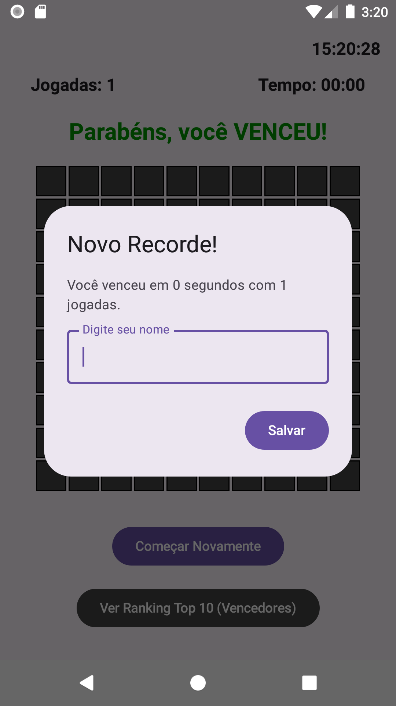
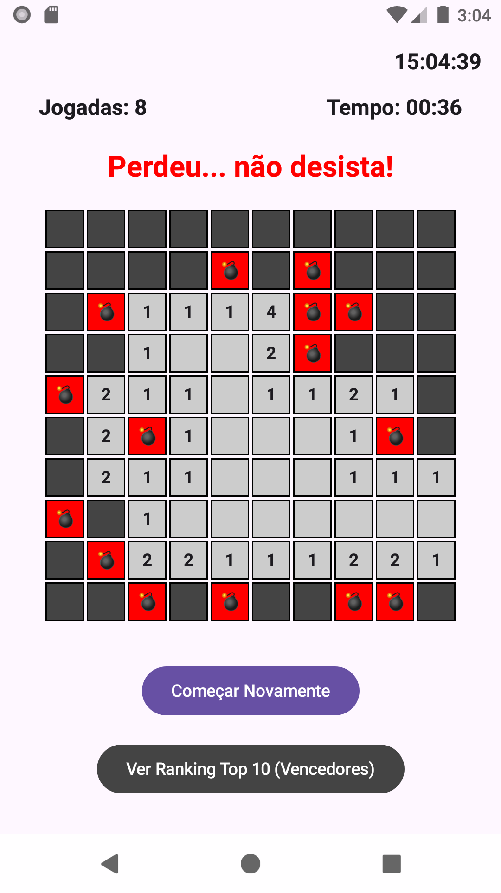

# Campo Minado - Android com Jetpack Compose 💣

Projeto de um jogo Campo Minado desenvolvido nativamente para Android utilizando Kotlin e Jetpack Compose.

## 🛠️ Tecnologias e Conceitos Utilizados
- **Interface UI:** Jetpack Compose (Lógica baseada em estado com `remember` e `mutableStateOf`).
- **Assincronismo:** Coroutines (`LaunchedEffect`) para a contagem contínua do cronómetro.
- **Persistência de Dados:** `SharedPreferences` para guardar, ordenar e carregar o Ranking Top 10 localmente no dispositivo.
- **Lógica de Jogo:** Algoritmo recursivo para abertura de casas vizinhas seguras.

## 📸 Capturas de Ecrã

### Jogo em Andamento (Cronómetro Ativo)

### Tela de Vitória (Pop-up de Registo no Ranking)

### Tela de Derrota (Tente Novamente)

### Sistema de Ranking Top 10
