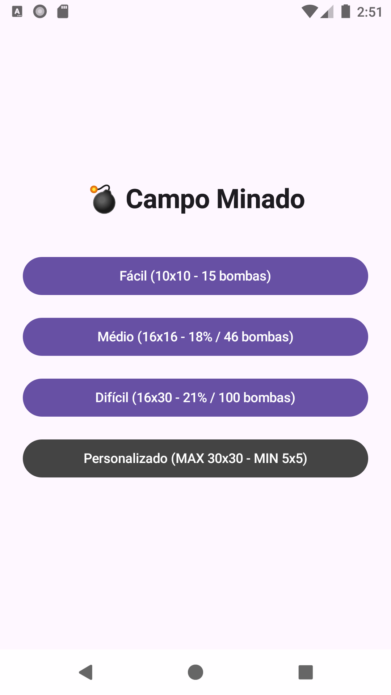
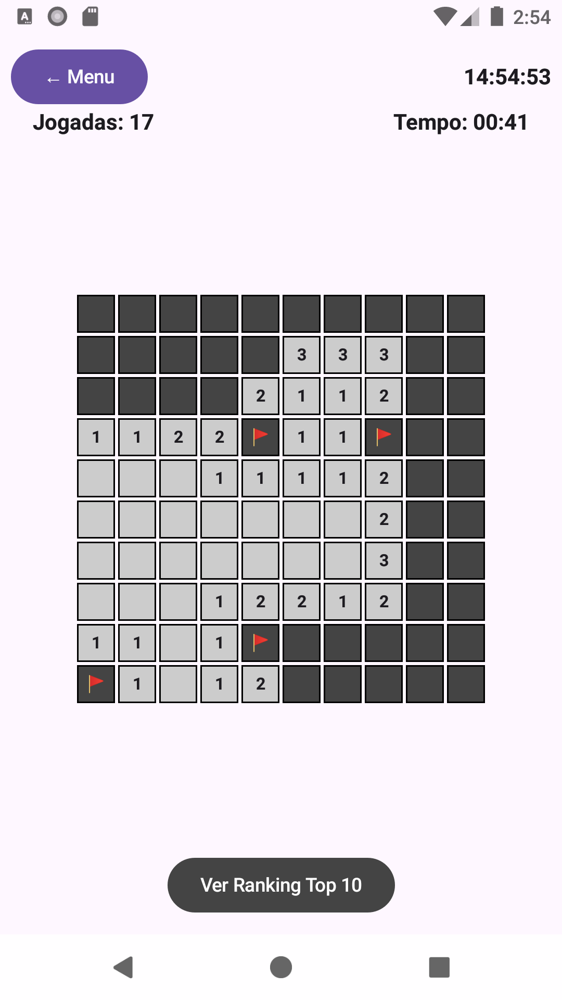
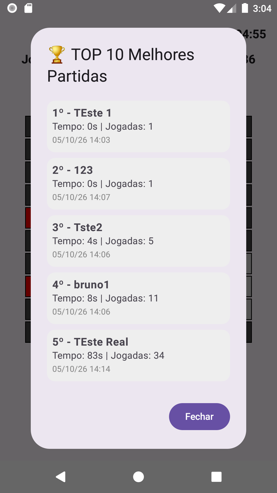

# Campo Minado - Android com Jetpack Compose 💣

Projeto de um jogo Campo Minado desenvolvido nativamente para Android utilizando Kotlin e Jetpack Compose.

## ✨ Novidades desta Versão
- **Níveis de Dificuldade:** Fácil (10x10), Médio (16x16), Difícil (16x30) e Personalizado (Min 5x5 / Max 30x30).
- **Sistema de Marcação:** Clique longo para adicionar Bandeiras (🚩).
- **Layout Responsivo:** Rotação automática e scroll horizontal/vertical para tabuleiros maiores.
- **Ranking Aprimorado:** O Top 10 agora registra a dificuldade em que a partida foi vencida.

## 🛠️ Tecnologias e Conceitos Utilizados
- **Interface UI:** Jetpack Compose (Lógica baseada em estado com `remember` e `mutableStateOf`).
- **Assincronismo:** Coroutines (`LaunchedEffect`) para a contagem contínua do cronômetro.
- **Persistência de Dados:** `SharedPreferences` para guardar, ordenar e carregar o Ranking Top 10 localmente no dispositivo.
- **Lógica de Jogo:** Algoritmo recursivo para abertura de casas vizinhas seguras.

## 📸 Capturas de Tela

### Menu de Dificuldades

### Jogo em Andamento (Bandeiras e Cronômetro)

### Sistema de Ranking Top 10 (Com Níveis)

